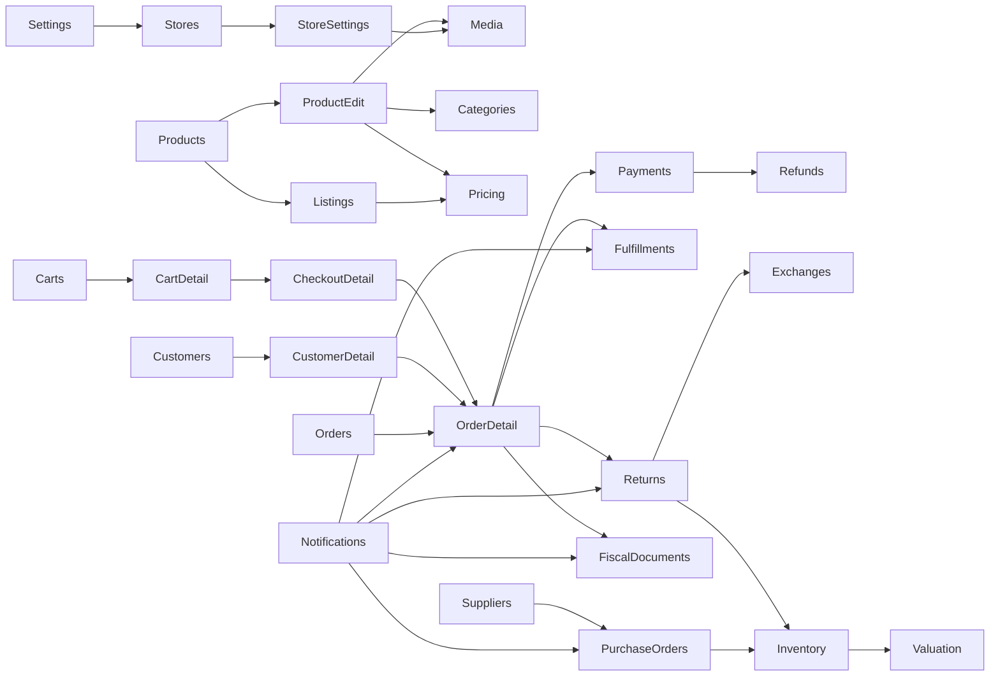

# Mapa de navegación administrativa

## Estructura actual

```text
Authentication
└─ Tenant selection / creation
   └─ Store selection / creation (cuando la ruta requiere Store)
      └─ AdminLayout
         ├─ Home: Dashboard
         ├─ Catalog: Products · Media · Categories · Listings · Promotions · Pricing
         ├─ Sales: Carts · Checkouts · Orders · Payments
         ├─ Operations: Fulfillment · Returns · Refunds · Exchanges · Customers
         ├─ Inventory: Stock · Valuation · Locations
         ├─ Procurement: Suppliers · Purchase orders
         ├─ Fiscal: Documents · Taxes
         ├─ Workspace: Activity
         ├─ Settings: General · Stores · Current store settings · Team · Notifications
         ├─ Notifications: Inbox · Preferences
         └─ Footer: Companies · Stores · Log out
```

La visibilidad se calcula con `currentTenantMembership.permissions`, pero el backend, Gates y las consultas scoped son la autoridad. El Dashboard mezcla secciones Store-scoped con Inventory/Procurement tenant-wide explícitamente rotuladas.

## Enlaces funcionales entre módulos



## Propuesta de arquitectura Stitch

Mantener todas las rutas y capacidades, reorganizando solo presentación:

1. **Overview:** Dashboard, Notifications.
2. **Catalog:** Products, Categories, Media, Listings.
3. **Merchandising:** Pricing, Promotions.
4. **Sales:** Orders, Carts, Checkouts, Payments, Refunds.
5. **Operations:** Fulfillments/Shipments, Returns, Exchanges.
6. **Customers:** Customers.
7. **Inventory:** Stock, Locations, Transfers, Valuation.
8. **Procurement:** Suppliers, Purchase Orders/Receipts.
9. **Compliance:** Taxes, Fiscal settings, Fiscal documents/SUNAT.
10. **Workspace:** Activity, Team/Access.
11. **Settings:** Company, Stores, Store settings, Payment settings, Notification preferences.

### Reglas

- Sidebar desktop de 248 px, colapsable a 72 px; drawer en mobile.
- Header persistente con breadcrumbs, Tenant/Store context, inbox y perfil.
- Tenant switch nunca implica Store/membership implícitos; Store switch nunca cambia Tenant membership.
- Los enlaces de detalle se mantienen; no se convierten en modales si contienen workflows extensos.
- No hacer prefetch indiscriminado de Dashboard, pagos, fiscal o páginas de detalle sensibles.
- Prefetch selectivo futuro solo para destinos frecuentes de lista y bajo permisos vigentes.

## Breadcrumbs propuestos

| Patrón | Breadcrumb |
|---|---|
| Index | Grupo / Pantalla |
| Create | Grupo / Entidad / Create |
| Edit | Grupo / Entidad / Nombre o código / Edit |
| Detail | Grupo / Entidad / Número o identificador corto |
| Settings | Settings / Dominio / Store cuando aplique |

## Responsive

- 1440: sidebar + header + contenido con tablas compactas.
- 768: sidebar drawer; filtros en dos columnas; tablas con columnas secundarias ocultables.
- 390: cards/rows apiladas para listados; acciones primarias sticky; filtros en drawer; nunca comprimir tablas de 8–20 columnas.
